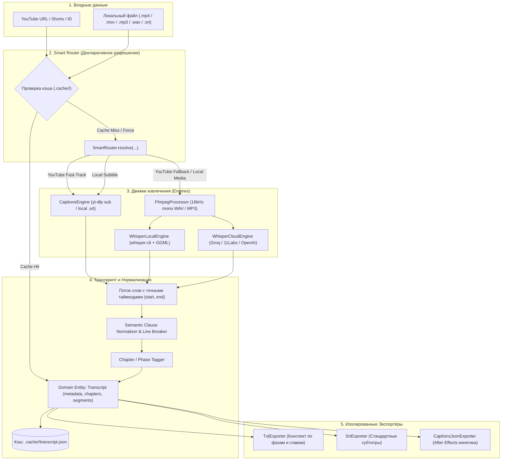

# Архитектура проекта Media-to-Text: Универсальный Комбайнер + Конвейер FFmpeg

Данный документ описывает модульную архитектуру проекта [`media-to-text`](file:///C:/Users/root/Desktop/media-to-text/), построенную на основе единого доменного контракта `Transcript`, декларативной маршрутизации стратегий, независимых экспортёров и слоя кэширования.

---

## 1. Концепция Pipeline (End-to-End)



---

## 2. Доменный контракт `Transcript`

Все источники (`YouTubeSource`, `LocalFileSource`) и все движки транскрибации (`WhisperLocalEngine`, `WhisperCloudEngine`, `CaptionsEngine`) возвращают нормализованные токены слов и формируют единую сущность `Transcript`:

```javascript
class Transcript {
  metadata: {
    title: string,
    id: string,
    url: string,
    channel: string,
    duration: number,
    source: "youtube" | "local-file",
    engine: "captions" | "local" | "groq" | "elevenlabs" | "openai",
    transcribedAt: string
  },
  chapters: [
    { id: 1, title: "Интро", start: 0.0, end: 105.0 }
  ],
  segments: [
    {
      id: 1,
      start: 1.25,
      end: 4.80,
      text: "ПОЛНЫЙ ТЕКСТ СЕМАНТИЧЕСКОЙ ФРАЗЫ",
      chapterId: 1,
      chapterTitle: "Интро",
      chapterRange: "00:00 - 01:45",
      lines: [
        {
          text: "ПОЛНЫЙ ТЕКСТ",
          style: "base",
          words: [{ w: "ПОЛНЫЙ", s: 1.25, e: 2.10 }, { w: "ТЕКСТ", s: 2.15, e: 2.80 }]
        }
      ],
      words: [...]
    }
  ]
}
```

Ни один движок (Whisper, Groq, YouTube) **ничего не знает о выходных форматах (.srt, .txt, .json)**. 

---

## 3. Декларативная маршрутизация (`SmartRouter`)

Вместо запутанных `if/else` логика выбора стратегии вынесена в чистый метод `SmartRouter.resolve(...)`:

```javascript
const resolution = SmartRouter.resolve({
  source: 'youtube' | 'file',
  hasCaptions: boolean,
  isSubtitleFile: boolean,
  engine: 'auto' | 'local' | 'groq' | 'elevenlabs' | 'openai',
  hasLocalWhisper: boolean,
  env: process.env
});
```

### Таблица стратегий:
| Вход | Субтитры доступны | Флаг `--engine` | Резолв стратегии | Описание |
| :--- | :--- | :--- | :--- | :--- |
| YouTube | Да | `auto` | `youtube-fast-track` | Выгрузка готовых субтитров (~1 сек, 0 байт видео) |
| YouTube | Нет | `auto` | `youtube-local-whisper` или `cloud` | Скачивание только аудиопотока ➔ Whisper |
| YouTube | Не важно | `local` | `youtube-local-whisper` | Принудительный локальный Whisper |
| YouTube | Не важно | `groq` | `youtube-cloud-whisper` | Принудительный Groq Whisper API |
| Файл (.srt/.vtt) | — | любой | `subtitle-file` | Мгновенный парсинг субтитров |
| Файл (медиа) | — | `auto` | `local-whisper` или `cloud` | Автовыбор: API-ключи из `.env` или локальный Whisper.cpp |
| Файл (медиа) | — | `local` | `local-whisper` | Ресемплинг FFmpeg ➔ 100% Offline Whisper.cpp |

---

## 4. Слой кэширования (`CacheManager`)

Кэш сохраняется в `.cache/<cache_key>/`:
* **YouTube**: Ключ — 11-значный video ID (например, `dQw4w9WgXcQ`).
* **Локальные файлы**: Ключ — MD5-хэш от пути, размера и даты модификации файла.

Содержимое папки кэша:
* `metadata.json` — название, автор, длительность, главы.
* `transcript.json` — скомпилированная доменная модель `Transcript`.
* `captions.srt` — исходные субтитры (при наличии).

Повторный запуск для обработанного ролика или файла отрабатывает за **< 0.1 секунды**.
Для обхода кэша предусмотрены флаги: `--no-cache` или `--force`.

---

## 5. Структура модулей проекта

```text
media-to-text/
├── transcribe.js              # Тонкий фасад (запуск src/cli/index.js)
├── transcribe.bat             # Drag & Drop и интерактивный запуск
├── package.json
├── ARCHITECTURE.md            # Данный документ
├── .cache/                    # Локальный кэш (в .gitignore)
└── src/
    ├── cli/
    │   └── index.js           # CLI-оркестратор
    ├── router/
    │   └── smart-router.js    # Декларативный резолвер стратегий
    ├── sources/
    │   ├── youtube.js         # YouTube: метаданные, главы, скачивание субтитров/аудио
    │   └── local-file.js      # Проверка локальных файлов и типов
    ├── media/
    │   ├── ffmpeg.js          # Нормализация в 16kHz mono WAV и MP3
    │   └── audio.js           # Проверка расширений медиафайлов
    ├── engines/
    │   ├── captions.js        # Парсер SRT/VTT в токены слов
    │   ├── whisper-local.js   # Запуск локального whisper-cli
    │   └── whisper-cloud.js   # Groq, ElevenLabs, OpenAI
    ├── transcript/
    │   ├── model.js           # Доменная модель Transcript
    │   ├── normalize.js       # Семантическая пагинация и расстановка переносов
    │   └── chapters.js        # Привязка сегментов к главам/фазам
    ├── exporters/
    │   ├── txt.js             # Структурированный конспект по фазам
    │   ├── srt.js             # Стандартный SRT
    │   └── captions-json.js   # Кинетический JSON для After Effects
    └── utils/
        ├── cache.js           # Менеджер кэша
        ├── env.js             # Загрузка .env
        ├── logger.js          # Красивый вывод в консоль
        └── paths.js           # Поиск бинарников и форматирование таймкодов
```
