# Архитектура проекта Media-to-Text: Универсальный Комбайнер + Конвейер FFmpeg

Данный документ описывает целевую архитектуру проекта [`media-to-text`](file:///c:/Users/root/Desktop/media-to-text/), объединяющего два контура обработки:
1. **YouTube Fast-Track (Лёгкая артиллерия)**: Мгновенное извлечение готовых субтитров через API без скачивания видео, с парсингом глав (таймкодов) ролика и разбивкой текста по смысловым фазам.
2. **FFmpeg + Whisper Heavy-Track (Тяжёлая артиллерия)**: Глубокая обработка любых локальных медиафайлов (MP3, WAV, MP4, MOV, MKV) либо роликов YouTube без готовых субтитров через передискретизацию FFmpeg и движки Whisper.

---

## 1. Общая архитектура Комбайнера (Smart Router)

Комбайнер определяет тип источника (URL YouTube или локальный файл) и выбирает наикратчайший и наименее ресурсоёмкий путь обработки:

```mermaid
flowchart TD
    Input["Входной источник (CLI / Drag & Drop / URL)"] --> Detector{"Определение типа источника"}
    
    %% Ветка YouTube
    Detector -->|"YouTube URL / ID"| YT_Route["YouTube Router"]
    YT_Route --> YT_SubCheck{"Есть субтитры на YT? (авто / ручные)"|field1}
    
    %% Fast Track
    YT_SubCheck -->|"Да (Fast-Track: ~1-2 сек)"| YT_Fetch["Извлечение субтитров (TimedText API)"]
    YT_Route --> YT_Chapters["Извлечение глав ролика (Video Chapters / Description)"]
    YT_Fetch --> YT_Aligner["Фазовый сопоставитель (Map Subtitles to Chapters)"]
    YT_Chapters --> YT_Aligner
    YT_Aligner --> Unified_Compiler["Универсальный Semantic Compiler"]
    
    %% Fallback YouTube в Heavy Track
    YT_SubCheck -->|"Нет субтитров"| YT_AudioStream["Скачивание только аудиопотока (yt-dlp / stream)"]
    YT_AudioStream --> FFmpeg_Engine
    
    %% Ветка локальных медиа
    Detector -->|"Локальный файл (Аудио / Видео)"| FFmpeg_Engine["FFmpeg Preprocessing Pipeline"]
    
    %% Heavy Track Whisper
    FFmpeg_Engine --> Engine_Router{"Выбор движка STT"}
    Engine_Router -->|"Офлайн / Бесплатно"| Local_Whisper["Local Whisper.cpp (CPU/GPU)"]
    Engine_Router -->|"Облако (Groq / 11Labs / OpenAI)"| Cloud_Whisper["Cloud Whisper API (Groq / Scribe)"]
    
    Local_Whisper --> Unified_Compiler
    Cloud_Whisper --> Unified_Compiler
    
    %% Выходные форматы
    Unified_Compiler --> Out_TXT["📄 Чистый текст (.txt) по главам/фазам"]
    Unified_Compiler --> Out_SRT["⏱️ Стандартные субтитры (.srt)"]
    Unified_Compiler --> Out_JSON["🎬 After Effects Кинетический JSON (.captions.json)"]
```

---

## 2. YouTube Fast-Track: Выгрузка субтитров и разбивка по фазам

### Как это работает:
1. **Нулевой сетевой оверхед**: Вместо скачивания сотен мегабайт видео/аудио отправляется легковесный запрос к API субтитров YouTube (`timedtext` / Innertube API). Трафик — **менее 100 КБ**, скорость — **~0.5–1.5 секунды**.
2. **Парсинг глав (Chapters / Phases)**:
   * Из описания и плеера видео извлекаются таймкоды глав (например: `00:00 - Интро`, `01:45 - Делистинг LINK`, `04:10 - Арбитражный круг`).
3. **Фазовое связывание (Phase Segmenter)**:
   * Субтитры группируются в блоки по главам ролика.
   * На выходе в `.txt` пользователь получает не сплошную стену текста, а красивый структурированный конспект с заголовками глав и временными диапазонами.
4. **Fallback-страховка**: Если автор ролика запретил субтитры или они отсутствуют, комбайнер не вылетает, а скачивает только аудиодорожку через `yt-dlp` и направляет её в FFmpeg метод.

---

## 3. Детальная архитектура FFmpeg метода (Heavy-Track)

FFmpeg отвечает за нормализацию любых непредсказуемых входных форматов, битрейтов и аудиокодеков перед подачей в Whisper:

```mermaid
flowchart LR
    subgraph Ingestion ["1. Приём медиа"]
        A["Входной контейнер (.mp4 / .mov / .mkv / .mp3 / .wav / .m4a / .flac)"]
    end

    subgraph Demux_Filter ["2. FFmpeg Demuxing & Normalization"]
        B["FFmpeg Stream Demuxer (-vn -sn -dn)"]
        C["Resampler Filter Graph (-ar 16000)"]
        D["Channel Downmixer (-ac 1 Mono)"]
        E["PCM Encoder (-c:a pcm_s16le 16-bit LE)"]
    end

    subgraph Buffer_VAD ["3. VAD & Audio Stream"]
        F["16kHz 16-bit Mono PCM Buffer / WAV"]
        G["Voice Activity Detection (Silence Skip)"]
    end

    subgraph Transcription ["4. Whisper Inference"]
        H["Whisper Decoder (ggml-base.bin / large-v3)"]
        I["Token-to-Word Timestamp Reconstructor"]
    end

    A --> B --> C --> D --> E --> F --> G --> H --> I
```



### Технические детали конвейера FFmpeg:
* **Флаги отсечения видео и метаданных**: `-vn -sn -dn` полностью исключают декодирование видео, субтитров и потоков данных, минимизируя нагрузку на CPU/RAM.
* **Частота дискретизации**: `-ar 16000` (16 кГц). Все акустические модели Whisper обучались на 16 кГц спектрограммах. Приведение любого звука (от 44.1/48 кГц студийного до 8 кГц телефонного) к 16 кГц гарантирует 100% совпадение шага окна mel-фильтров.
* **Моно-микширование**: `-ac 1`. Устраняет фазовые искажения стерео/surround и в 2 раза уменьшает объём памяти для декодера.
* **Формат данных**: `pcm_s16le` (16-битный PCM без сжатия) обеспечивает мгновенное чтение Whisper без задержек на разжатие кодеков.

---

## 4. Структура проекта `media-to-text`

```
media-to-text/
├── .env                     # API ключи (Groq, ElevenLabs, OpenAI, опционально YouTube)
├── .env.example             # Шаблон конфигурации
├── .gitignore               # Игнорирование моделей, кэша, выходных медиа
├── package.json             # Зависимости проекта
├── README.md                # Документация пользователя
├── ARCHITECTURE.md          # Данная архитектурная спецификация
├── transcribe.bat           # Быстрый Drag & Drop раннер (CMD chcp 65001)
├── index.js                 # Главный комбайнер (Smart Router: YT URL vs Local Media)
├── src/
│   ├── youtube/
│   │   ├── yt_subtitles.js  # Извлечение субтитров (Fast-Track)
│   │   └── yt_chapters.js   # Парсер глав и фаз ролика
│   ├── ffmpeg/
│   │   ├── ffmpeg_runner.js # Автопоиск FFmpeg и нормализация в 16kHz mono
│   │   └── whisper_local.js # Модуль локального whisper-cli
│   └── compiler/
│       ├── semantic_page.js # Разбивка на смысловые фразы
│       └── formatters.js    # Экспортёры: .txt (с главами), .srt, .json
```

---

## User Review Required

> [!IMPORTANT]
> 1. **YouTube-субтитры (Fast-Track)**: Будем извлекать как ручные, так и автосгенерированные субтитры YouTube на любом доступном языке (с автоопределением основного языка ролика).
> 2. **Разделение по фазам (Chapters)**: В итоговом `.txt` файле будут автоматически проставлены разделители глав ролика, например:
>    ```text
>    ========================================================
>    📍 Фаза 1: Введение и предыстория (00:00 - 02:15)
>    ========================================================
>    Текст первой смысловой части...
>
>    ========================================================
>    📍 Фаза 2: Арбитражный спред и делистинг (02:15 - 05:40)
>    ========================================================
>    Текст второй части...
>    ```
> 3. **Входные данные**: В батник или консоль можно передавать:
>    * Ссылку на видео (`https://www.youtube.com/watch?v=...` или `https://youtu.be/...`)
>    * Локальный файл или группу файлов (Drag & Drop на `transcribe.bat`).

---

## Open Questions

Нет блокирующих вопросов. Все необходимые компоненты (Node.js, FFmpeg, Whisper) уже проверены в системе.

---

## Verification Plan

1. **Тест YouTube Fast-Track**:
   * Запуск на тестовом ролике с главами и субтитрами.
   * Проверка скорости (< 2 секунд без скачивания видео).
   * Проверка корректного сопоставления текста с главами в `.txt`.
2. **Тест YouTube Fallback**:
   * Запуск на ролике без субтитров (проверка переключения на стриминг аудиопотока и FFmpeg + Whisper).
3. **Тест Локального FFmpeg + Whisper**:
   * Запуск на локальном файле `reels_girl_test_part1.mp3`.
4. **Тест Drag & Drop**:
   * Проверка перетаскивания ссылок / файлов на батник.
